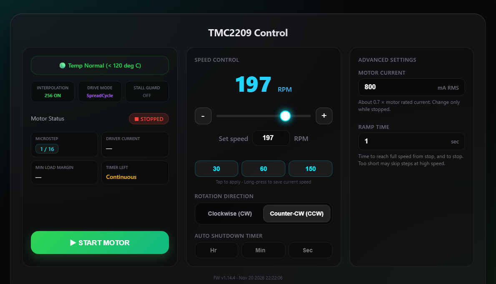

# 🚀 ESP32 TMC2209 Web Controller

用 ESP32 + TMC2209 做的步進馬達網頁控制面板。連上 ESP32 的 Wi-Fi 熱點，就能用手機或電腦控制。



---

## ✨ 功能

**操作**
* 轉速 0.1 ~ 450 RPM：拉桿、+/- 鍵或直接輸入
* 三顆快捷鍵（預設 30 / 60 / 150 RPM），長按可存入目前轉速
* 正反轉、倒數計時自動停止、可調加減速時間（0.2 ~ 10 秒）
* 電流可調 200 ~ 1200 mA（只能在馬達完全停止時修改）
* 設定斷電保留；多個分頁或手機會同步顯示
* 響應式版面：手機、平板、電腦都好用
* OTA 無線更新韌體

**自動微步與模式**

| 轉速 | 微步 | 模式 |
| :--- | :--- | :--- |
| ≤ 45 RPM | 1/64 | StealthChop（靜音） |
| 45 ~ 130 RPM | 1/32 | StealthChop（靜音） |
| > 130 RPM | 1/16 | SpreadCycle（高扭力） |

切換只在馬達完全停止時進行（運轉中會先減速停止再切換）。StealthChop 在約 150 RPM 以上會自己失步，所以 130 RPM 以上改用 SpreadCycle。

**安全保護**
* **過熱**：超過 150°C 自動停機，降溫後解除
* **卡住偵測**：30 ~ 130 RPM 有效，卡住約 1~2 秒內停機（建議電流 ≤ 800 mA）
* **線圈短路**：立即停機；**線圈斷線**：顯示警告
* **UART 斷線**：連續 3 秒讀不到驅動器就停機
* **驅動器重新上電**：自動重寫並確認設定，確認前禁止啟動
* 安全監控在獨立任務執行，網頁連線慢也不會延誤停機

> ⚠️ 130 RPM 以上沒有卡住偵測（TMC2209 的限制）。

---

## 🔌 接線

### ESP32 ↔ TMC2209

| ESP32 | TMC2209 | 說明 |
| :--- | :--- | :--- |
| GPIO 13 | EN | 低電位啟用；**加 10kΩ 上拉到 3V3** |
| GPIO 16 | UART（第 4 腳） | 直接連接 |
| GPIO 17 | UART（第 4 腳） | **串聯 1kΩ** 後併入 UART 線 |
| GPIO 14 | STEP | 步進脈衝 |
| GPIO 12 | DIR | 轉向 |
| 3V3 | VIO | 邏輯電源（勿接 5V） |
| GND | GND | 必須共地 |

### TMC2209 腳位（FLY TMC2209）

```
訊號排（從 EN 數起）              電源排
 1  EN    ← GPIO 13              VM   ← 24V (+) ┐ 100µF 電容
 2  MS1   不接（位址 0）          GND  ← 24V (-) ┘ 
 3  MS2   不接（位址 0）          B2 ┐
 4  UART  ← GPIO 16 / 17(1kΩ)    B1 │ 步進馬達
 5  PDN   不接                    A1 │
 6  CLK   不接                    A2 ┘
 7  STEP  ← GPIO 14              VIO  ← ESP32 3V3
 8  DIR   ← GPIO 12              GND  ← ESP32 GND
```

### 必要的周邊零件

| 零件 | 接法 | 用途 |
| :--- | :--- | :--- |
| 1kΩ 電阻 | GPIO 17 → UART 線 | 單線 UART 必要 |
| 10kΩ 電阻 | GPIO 13 ↔ 3V3 | ESP32 開機、重開或當機時，讓驅動器保持關閉 |
| 100µF / 50V 電解電容 | VM ↔ 旁邊的 GND，靠近模組 | 吸收電壓突波，保護 TMC2209（注意極性） |

### 供電

```
24V ─┬─ 風扇
     ├─ 降壓模組 → 5V → ESP32
     └─ TMC2209 VM
```

> ⚠️ UART 一定要接**第 4 腳**。接到第 5 腳（PDN）馬達仍會轉，但設定都寫不進去，轉速會不對。
>
> ⚠️ 不要在通電時拔插馬達線。
>
> 🔍 開啟 `http://192.168.4.1/diag`，看到 `<-- FOUND` 代表 UART 正常。

---

## 🚀 快速開始

1. 用 Arduino IDE 安裝函式庫：`TMCStepper`、`FastAccelStepper`
2. 複製 `secrets.example.h` 為 `secrets.h`，填入熱點密碼（至少 8 字元）與 OTA 密碼（此檔不會被 commit）
3. 第一次用 USB 燒錄
4. 連上熱點 `TMC2209_Motor_Ctrl`，開啟 `http://192.168.4.1`

### OTA 更新

Arduino IDE → **工具 → 連接埠** 選 `ESP32-TMC2209-Control at 192.168.4.1`，上傳時輸入 OTA 密碼。

> 卡在 `Waiting for device`：把 `TMC2209_Motor_Ctrl` 網路設為「私人網路」（Windows 防火牆）。
