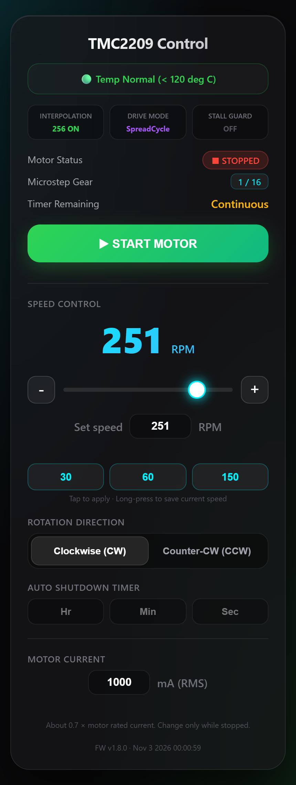

# 🚀 ESP32 TMC2209 Web Controller

基於 ESP32 與 TMC2209 步進馬達驅動器的深色現代化 Web 控制面板。支援動態微步與驅動模式切換、256 微步插值、卡住偵測、接線故障偵測、即時溫度監控與過熱保護、可調加減速時間、斷電記住設定、自動關機計時器以及 OTA 無線更新。



---

## ✨ 特色功能 (Features)

* **現代化 UI**：深色科技感介面，支援即時狀態監控（溫控、驅動模式、RPM、計時器），頁面底部顯示韌體版本與編譯時間。
* **轉速範圍 0.1 ~ 450 RPM**：非線性拉桿方便低速微調，也可在「Set speed」輸入框直接輸入轉速；10 RPM 以上取整數、以下精確到 0.1。超出範圍自動限制，無效數值（非數字、0、負數）會被拒絕並保留原轉速。
* **常用轉速快捷鍵**：三顆按鈕（預設 30 / 60 / 150 RPM），點一下套用；長按 0.7 秒可把目前轉速存進該按鈕，斷電後保留。
* **依轉速自動切換微步與驅動模式**：

  | 轉速 | 微步 | 驅動模式 |
  | :--- | :--- | :--- |
  | ≤ 45 RPM | 1/64 | StealthChop（靜音） |
  | 45 ~ 160 RPM | 1/32 | StealthChop（靜音） |
  | > 160 RPM | 1/16 | SpreadCycle（高扭力） |

  跨越區間時，馬達會先減速停止、切換設定後再加速。模式只在停止時切換：高速運轉中由 SpreadCycle 切回 StealthChop 會讓馬達卡住並發出異音。界線刻意設在 160 RPM，避開常用的 150 RPM（可在程式中的 `SPREADCYCLE_RPM_THRESHOLD` 調整）。網頁顯示的是驅動器回報的實際模式。
* **高階 TMC2209 優化**（透過 UART 設定）：
  * **Microplyer (256 插值)**：自動平滑化脈衝，降低運轉高頻噪音。
  * **運轉電流**：可在網頁「Motor Current」設定 200 ~ 1200 mA (RMS)，預設 800 mA。只能在馬達停止時修改。換馬達時請設為馬達額定電流的約 0.7 倍，不確定時先設低再慢慢調高。運轉中狀態區的「Driver Current」顯示驅動器回報的實際電流，可用來確認設定已生效。
* **斷電記住設定**：轉速、轉向、電流、加減速時間會存在 ESP32 的 Flash，重新通電後自動恢復。為避免影響運轉流暢度，只在馬達停止時寫入（運轉中調整的值會在按下 STOP 後儲存）。
* **過熱安全保護**：每秒透過 UART 讀取晶片溫度旗標，溫度框依狀態變色（綠／黃／紅）。超過 150°C 或晶片過熱關斷時自動停止馬達並禁止啟動，降溫後自動解除。
* **卡住偵測 (StallGuard4)**：在 30 ~ 160 RPM（StealthChop）之間，達到目標轉速後自動記錄正常負載作為基準；最近 6 次取樣（約 0.3 秒）中有 3 次負載讀值低於基準的 35% 時，立即停止馬達並顯示紅色警告，按 START 即可重新啟動。採用「6 次中 3 次」而非「連續 3 次」，是因為馬達被卡住跳步時讀值會高低交錯；單次雜訊則不會誤判。
  * 網頁「Stall Guard」格顯示目前負載相對基準的百分比（越低越吃力）；「Min Load Margin」顯示本次運轉中最吃力時的餘裕（與停機門檻同一標準，低於 35% 即停機）。
  * ⚠️ **電流建議 ≤ 800 mA**：實測 800 mA 時擰住軸心可在 1~2 秒內停機；1000 mA 時馬達掙扎力較大，讀值只降到約 40~57%，不會觸發。電流設定超過 800 mA 時網頁會顯示提醒。
  * 低於 30 RPM 或高於 160 RPM 時偵測不準，因此不啟用。敏感度可調整程式中的 `STALL_RATIO`；除錯時可開啟 `/sg` 查看最近 2 秒的原始讀值。
* **接線故障偵測**：每秒讀取驅動器的接線旗標。
  * **線圈短路**（對地或對電源）：立即停止馬達、禁止啟動，並顯示紅色警告。
  * **線圈斷線**（插頭鬆脫等）：顯示黃色警告。斷線旗標在高速與靜止時可能誤報，因此只在 StealthChop 區間等速運轉時判斷，且需連續 3 秒才警告，不會停機。
  * ⚠️ 請勿在通電時拔插馬達線，可能損壞 TMC2209。
* **UART 斷線保護**：連續 3 秒讀不到驅動器時視為故障，停止馬達並禁止啟動（避免在無法監控溫度的情況下運轉）。
* **診斷頁 `/diag`**：顯示驅動器原始暫存器、UART 位址與腳位掃描、回音測試，方便排查接線問題。
* **智慧定時器 (Auto Shutdown Timer)**：設定倒數時間，時間到自動停止馬達。
* **可調加減速時間 (Ramp Time)**：網頁「Ramp Time」設定 0.2 ~ 10 秒（預設 5 秒），代表從靜止加速到目標轉速、以及從目前轉速減速到停止所需的時間；運轉中修改會立即套用。改變轉速時也以同樣的時間到達新轉速（以較高的那個轉速為基準），不會因為從高速調到極低轉速而減速很久。時間太短在高轉速或負載重時容易失步；按 STOP、故障停機、計時結束時都會依這個時間減速停止。
* **OTA 無線燒錄**：支援透過 Wi-Fi 直接進行韌體更新。

---

## 🔌 硬體接線 (Pinout & Hardware)

### ESP32 ↔ TMC2209 訊號線

| ESP32 GPIO | TMC2209 腳位 | 說明 |
| :--- | :--- | :--- |
| **GPIO 13** | EN（第 1 腳） | 驅動器啟用（低電位啟用） |
| **GPIO 16 (RX2)** | UART（第 4 腳） | UART 訊號輸入，**直接**連至 UART 線 |
| **GPIO 17 (TX2)** | UART（第 4 腳） | UART 訊號輸出，**需串聯 1kΩ 電阻**後併入 UART 線 |
| **GPIO 14** | STEP（第 7 腳） | 步進訊號脈衝 |
| **GPIO 12** | DIR（第 8 腳） | 馬達轉向控制 |
| **3V3** | VIO | 邏輯電源（勿接 5V） |
| **GND** | GND | 必須與驅動器共地 |

### TMC2209 模組腳位（以 FLY TMC2209 為例）

```
訊號排針（從 EN 端數起）          電源排針
 1  EN    ← GPIO 13                VM   ← 12~24V 電源 (+)
 2  MS1   （不接 → 位址 0）         GND  ← 12~24V 電源 (-)
 3  MS2   （不接 → 位址 0）         B2   ┐
 4  UART  ← GPIO 16 + GPIO 17(1kΩ) B1   │ 步進馬達
 5  PDN   （不接）                  A1   │ 兩組線圈
 6  CLK   （不接）                  A2   ┘
 7  STEP  ← GPIO 14                VIO  ← ESP32 3V3
 8  DIR   ← GPIO 12                GND  ← ESP32 GND
```

```
GPIO 16 ──────────────┐
                      ├──── UART 線 ────► TMC2209 第 4 腳 (UART)
GPIO 17 ──[ 1kΩ ]─────┘
```

> ⚠️ **UART 一定要接第 4 腳**：插到第 5 腳 (PDN) 時馬達**仍然會轉**，但 UART 不通，電流、微步、模式等所有參數都不會寫入驅動器（驅動器會改用模組上的 Vref 旋鈕與 MS1/MS2 腳位決定的 1/8 微步，實際轉速會比畫面顯示快 2~8 倍）。
>
> 🔋 **馬達電源**：VM 需接 12~24V，建議在 VM 與 GND 旁並聯 100µF 以上電解電容。TMC2209 需要 VM 有電，UART 才會回應。
>
> 🔍 **診斷**：連上熱點後開啟 `http://192.168.4.1/diag`，看到 `version=0x21` 與 `<-- FOUND` 即代表 UART 正常；網頁溫度框若顯示 `⚪ Driver UART Error`，請先檢查 UART 接線。

---

## 🛠️ 第三方函式庫需求 (Dependencies)

請在 Arduino IDE 的「函式庫管理員」中安裝以下 Library：

1. **`TMCStepper`** by teemuatlut
2. **`FastAccelStepper`** by Gin66
3. **`ArduinoOTA`** (ESP32 核心內建)

---

## 🚀 快速開始 (Quick Start)

1. 下載或 Clone 本專案至本地資料夾：
   ```bash
   git clone https://github.com/Eggisgood69/ESP32-TMC2209-Web-Control.git
   ```
2. 將 `secrets.example.h` 複製為 `secrets.h`，填入 Wi-Fi 熱點密碼（至少 8 字元）與 OTA 密碼。`secrets.h` 已列入 `.gitignore`，不會被 commit。
3. 第一次請用 USB 燒錄。之後可用 OTA 更新（見下方）。
4. 手機或電腦連上 Wi-Fi 熱點 `TMC2209_Motor_Ctrl`，以瀏覽器開啟 `http://192.168.4.1`。

---

## 📡 OTA 無線更新

1. 電腦連上 `TMC2209_Motor_Ctrl` 熱點。
2. Arduino IDE → **工具 → 連接埠**，選擇 `ESP32-TMC2209-Control at 192.168.4.1`。
3. 上傳時輸入 `secrets.h` 裡設定的 OTA 密碼。
4. 完成後裝置自動重開，頁面底部的版本號會更新。

> 💡 **常見問題**
> * **`No response from the ESP`**：請確認電腦上的 ESP32 核心版本與當初燒錄的版本相容（3.3.1 之後的核心改用新的 OTA 驗證方式）。
> * **驗證成功但卡在 `Waiting for device`**：Windows 防火牆擋住了回連。可將 `TMC2209_Motor_Ctrl` 網路設為「私人網路」。

---

## 🧭 未啟用的功能

* **CoolStep（依負載自動調整電流）**：目前刻意關閉（`semin(0)`）。實測 800 mA 連續運轉溫度正常，暫不需要；若日後需要省電或降溫再加入，需依馬達與負載調整 `TCOOLTHRS`、`semin`、`semax` 等參數，設定不當可能失步。
